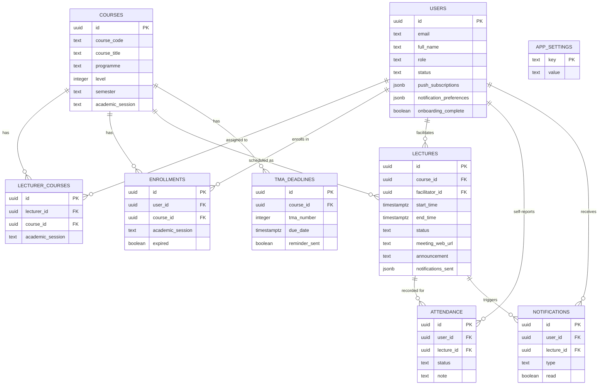
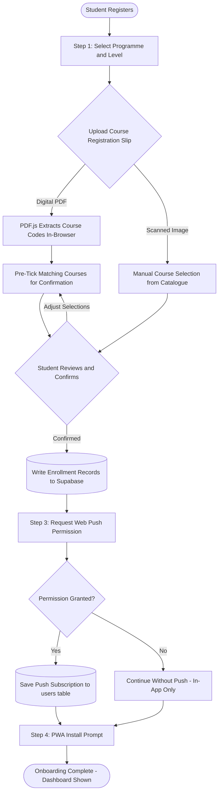
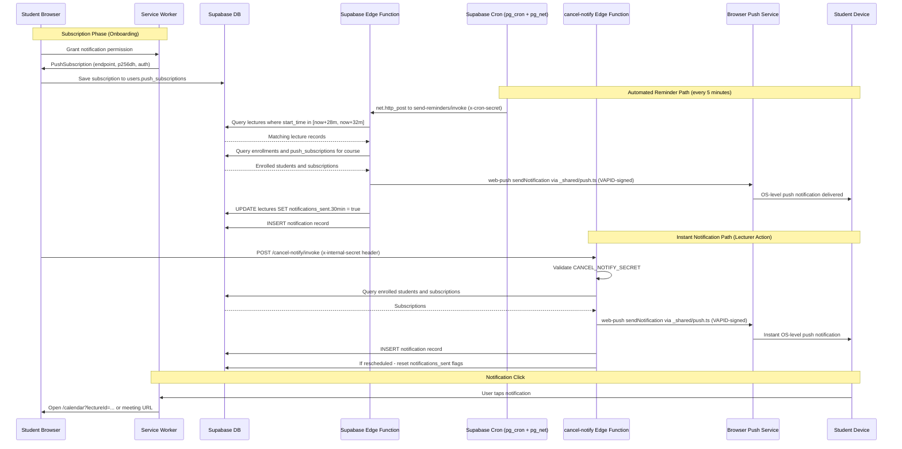
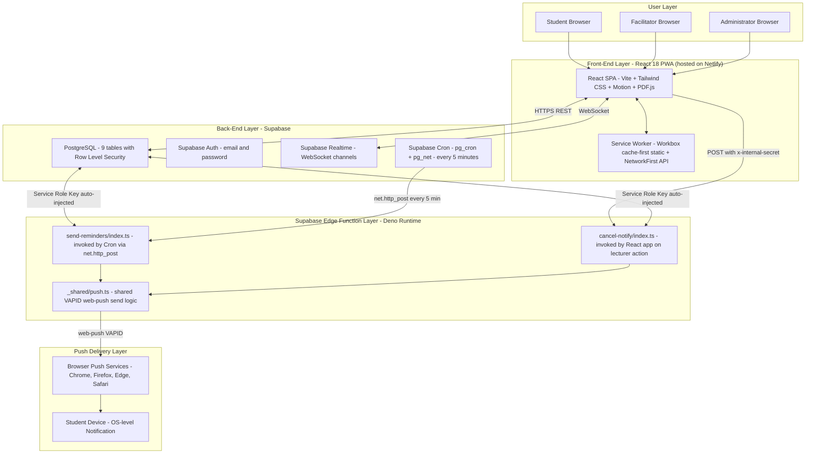

# Smart Lecture Reminder — Updated UML Diagrams
# Render each block at https://mermaid.live then insert the image into the report
# at the corresponding figure placeholder position.
#
# CHANGED FROM ORIGINAL:
# - Figure 3.4.4 (Sequence Diagram): Netlify Scheduled Function → Supabase Edge Function
#   invoked by Supabase Cron (pg_cron + pg_net)
# - Figure 3.4.5 (System Architecture): "Netlify Serverless Function Layer" →
#   "Supabase Edge Function Layer"; Netlify now appears only as static hosting
#
# Figures 3.4.1, 3.4.2, 3.4.3 are UNCHANGED — use existing rendered images.

---

## Figure 3.4.1 — Use Case Diagram (UNCHANGED)
## Use at https://mermaid.live — no changes needed from original

```mermaid
graph TD
    Admin([Administrator])
    Lecturer([Lecturer / Facilitator])
    Student([Student])

    UC1(Register / Login / Forgot Password)
    UC2(Approve Pending Lecturer)
    UC3(Manage Lecture - Full CRUD)
    UC4(Bulk Import Lectures via CSV)
    UC5(Manage TMA Deadlines)
    UC6(Manage Users)
    UC7(Manage Semester Settings)
    UC8(Reschedule Assigned Lecture)
    UC9(Cancel Assigned Lecture with Reason)
    UC10(Post Lecture Announcement)
    UC11(Add Recording URL)
    UC12(Complete Onboarding - Upload Reg Slip)
    UC13(View Personalized Calendar)
    UC14(Receive Push Notifications)
    UC15(Self-Track Attendance)
    UC16(Manage Notification Preferences)
    UC17(Install PWA / Use Offline)

    Admin --> UC1
    Admin --> UC2
    Admin --> UC3
    Admin --> UC4
    Admin --> UC5
    Admin --> UC6
    Admin --> UC7

    Lecturer --> UC1
    Lecturer --> UC8
    Lecturer --> UC9
    Lecturer --> UC10
    Lecturer --> UC11

    Student --> UC1
    Student --> UC12
    Student --> UC13
    Student --> UC14
    Student --> UC15
    Student --> UC16
    Student --> UC17

    UC8 -.triggers.-> UC14
    UC9 -.triggers.-> UC14
    UC10 -.triggers.-> UC14
    UC11 -.triggers.-> UC14
    UC3 -.triggers.-> UC13
```

---

## Figure 3.4.2 — Entity Relationship Diagram (UNCHANGED)
## No changes needed from original

---

## Figure 3.4.3 — Activity Diagram: Student Onboarding (UNCHANGED)
## No changes needed from original

---

## Figure 3.4.4 — Sequence Diagram: Push Notification Delivery (UPDATED)
## CHANGED: Netlify Scheduled Function → Supabase Edge Function invoked by pg_cron + pg_net

---

## Figure 3.4.5 — System Architecture Diagram (UPDATED)
## CHANGED: "Netlify Serverless Function Layer" removed; Supabase Edge Function Layer added;
##          Netlify now appears only as Static Hosting in the Front-End layer

